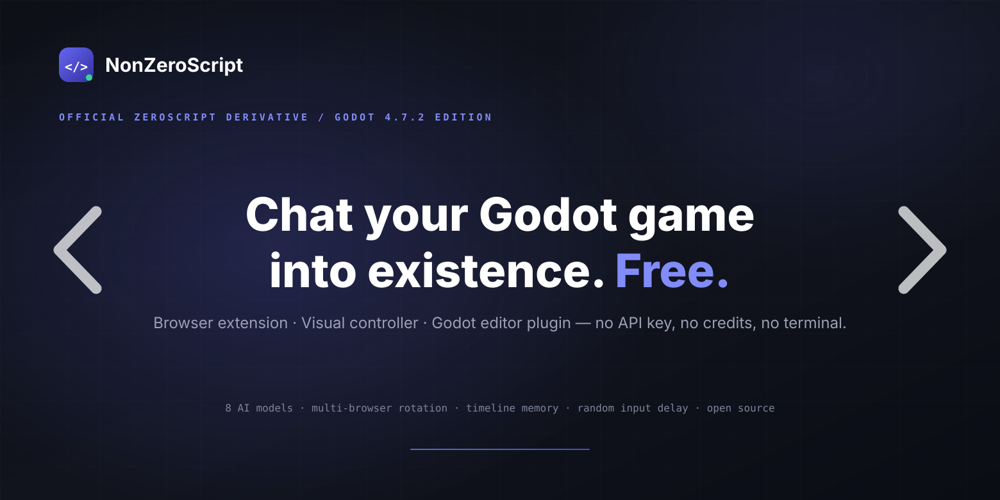

# NonZeroScript - Free AI Agent for Your Game Editor

-lightgrey)




**NonZeroScript** is the **official derivative of [ZeroScript](https://github.com/sebattfg/ZeroScript-Free)**, rebuilt for **game editors** instead of Roblox Studio. It turns ChatGPT, DeepSeek, Gemini, Kimi, GLM, Qwen, Meta AI or Arena into a real editor agent: read and write **GDScript or C#**, create scenes and nodes, change project settings, run play-tests and read errors — all from a normal AI chat, with **no API key and no terminal**.

It is **multi-editor by design**: the browser extension and the console only speak one small editor-agnostic protocol, and every editor has its own plugin folder under `editor/`. **Godot 4.7.2 (GDScript + C#) works today**; other engines plug into the same protocol. See [`editor/PROTOCOL.md`](editor/PROTOCOL.md).

> **Official derivative.** NonZeroScript is the ZeroScript project's multi-editor edition — an official derivative maintained alongside the original, not an unrelated fork. The Roblox Studio integration, the Roblox MCP bridge and Roblox-specific instructions are intentionally **not** part of this edition. Everything else — the browser-extension agent loop, the command protocol and the free-forever promise — comes from ZeroScript and remains GPL-3.0.

> 🌐 Upstream ZeroScript: **[zerodev.tools/zeroscript](https://zerodev.tools/zeroscript)** · [github.com/sebattfg/ZeroScript-Free](https://github.com/sebattfg/ZeroScript-Free)

## What changed from ZeroScript

| | ZeroScript (Roblox) | **NonZeroScript (Godot)** |
|---|---|---|
| Target | Roblox Studio via MCP | **Any game editor via a plugin** (Godot 4.7.2 included) |
| Control | Small bar in the chat + CLI bridge | **Visual console + local relay**, no command line |
| Input pacing | Fixed internal waits | **Random wait between a minimum and maximum number of seconds before every simulated input** |
| Browsers | One tab | **You choose which browsers join**; two or more enable rotation, with a shared timeline memory |
| Memory | Per-place project memory | **Timeline files per task and per browser session**, used to hand work between browsers |
| Providers | 8 | **8: ChatGPT, DeepSeek, Gemini, Kimi, GLM, Qwen, Meta AI, Arena** (ChatGPT support updated) |

## How it works

```
 ┌─────────────────────────────┐        ┌──────────────────────────────┐
 │  Browser (Chrome / Edge)     │        │  Your editor                 │
 │  ChatGPT · DeepSeek · Gemini │        │  editor/<adapter>/           │
 │  Kimi · GLM · Qwen · Meta    │        │  Godot 4.7.2 today,          │
 │  Arena                       │        │  any engine that speaks the   │
 │        ▲   browser extension │        │  bridge protocol             │
 └────────┼─────────────────────┘        └────────┼─────────────────────┘
          │  HTTP (localhost)                     │  HTTP poll (localhost)
          ▼                                       ▼
 ┌──────────────────────────────────────────────────────────────────────┐
 │  controller/  — visual console + local relay + rotation + memory      │
 │  http://127.0.0.1:8790                                                │
 └──────────────────────────────────────────────────────────────────────┘
```

1. The **browser extension** runs inside the AI chat page. It types the prompt, waits for the answer, parses **one** command and reports it.
2. The **controller** is a small local program (Python standard library only). It shows a **visual console**, decides which browser tab gets the next turn (round-robin), executes the command through the editor and stores the timeline.
3. The **editor plugin** performs the real work in your project: files, scenes, nodes, project settings, play-tests and logs. The shipped adapter is Godot 4.7.2; the protocol is the same for any editor.

No cloud service is involved. Everything runs on your machine, and the only network traffic is between your browser, the controller and Godot on `127.0.0.1`.

## Features

- **Visual console instead of a command line.** Start the controller by double-clicking a script; the console opens in your browser. Queue tasks, watch sessions, inspect the timeline, edit the delay and rotation settings.
- **Random input delay.** Set a minimum and maximum number of seconds (e.g. 2–6 s). Before every simulated input — the startup prompt, a task, or a tool result — NonZeroScript waits a random time in that range. This is much gentler on AI sites than instant, regular automation.
- **You pick the browsers.** Open as many browsers or tabs as you like, press **启动 / Start** in each, then tick **轮换** only for the ones that should take turns. One ticked session = single-browser mode; **two or more ticked sessions turn rotation on** (round-robin), and the console always shows which mode is active.
- **Three performance modes.** **极致性能 / eco** keeps the relay tiny (target: **under 30 MB RAM**, small logs, slow UI refresh), **平均 / balanced** is the default, and **最快速度 / turbo** polls hardest and keeps the longest results. One dropdown, no restart.
- **Timeline memory.** Each browser AI has its own private chat context, so rotation would normally lose the plot. The controller writes every prompt, reply and tool result to `controller/data/memory/` and prepends a compact **memory brief** to the next turn, whichever browser gets it.
- **A real editor toolset** — 29 commands for the Godot adapter (GDScript **and** C#): read/search/write/edit files, inspect and edit the open scene, add/remove nodes, instance scenes, change project settings, run and stop the game, read the editor log and capture a screenshot for the human.
- **ChatGPT support updated** for the current composer, alongside DeepSeek, Gemini, Kimi, GLM, Qwen, Meta AI and Arena.
- **Free and open source.** GPL-3.0, no account, no subscription, no API key.

## Download and install

Four separate packages in [`dist/`](dist). You need the first three; `prompts.zip` is the reference copy of what the AI is told.

| Package | What it is | Where it goes |
|---|---|---|
| **`controller.zip`** | visual console + local relay | anywhere, double-click the launcher |
| **`extension.zip`** | Chrome / Edge extension | load unpacked, keep the folder |
| **`editor-godot-4.7.2.zip`** | Godot 4.7.2 plugin | `addons/nonzeroscript` in your project |
| `prompts.zip` | the instructions the AI is given | read-only reference |

Each one contains its own `INSTALL.txt`. Download, extract, then follow the three steps below.

> **Platforms:** Windows 10/11 and macOS, 64-bit and 32-bit. **Linux is not supported** — no Linux launcher, no Linux package, no Linux instructions.

### 1. The controller (visual console + relay)

- Install **Python 3.9 or newer** ([python.org/downloads](https://www.python.org/downloads/)). Nothing else is needed — no `pip install`.
- Open the `controller` folder and double-click:
  - **Windows 10/11 (64-bit or 32-bit):** `start.bat`
  - **macOS (64-bit or 32-bit):** `start.command` (first launch: right-click → Open, or allow it in *System Settings → Privacy & Security*)
- A console window opens and your browser shows **http://127.0.0.1:8790/** — the visual console.

> Keep the controller window open while you work. Closing it stops the relay. Changing the port requires a restart.

### 2. The browser extension (Chrome / Edge)

The same extension works in both browsers.

1. Open `chrome://extensions` (Chrome) or `edge://extensions` (Edge).
2. Turn on **Developer mode**.
3. Click **Load unpacked** and select the extracted `extension` folder.
4. Optional: pin NonZeroScript to the toolbar.

### 3. The Godot 4.7.2 editor plugin

1. In the extracted archive (or the `editor/godot-4.7.2` folder in this repository) you will find the plugin. Copy it into your Godot project so the path becomes:

   ```
   your_project/
     project.godot
     addons/
       nonzeroscript/
         plugin.cfg
         plugin.gd
         core/
         ui/
   ```

2. In Godot: **Project → Project Settings → Plugins** → enable **NonZeroScript**.
3. A **NonZeroScript** dock appears on the right. It should show `● 已连接` (connected) once the controller is running.
4. Check the URL in the dock: `http://127.0.0.1:8790`. If you changed the controller port, change it here too and click **应用**.

That's it. The editor now exposes its tools to the local controller — it never listens for inbound connections itself.

## Other editors

The console and the extension do not know Godot; they only know the bridge protocol described in [`editor/PROTOCOL.md`](editor/PROTOCOL.md). Every editor is one folder (`editor/<engine>/`) with its own plugin, its own download and the same commands. **Godot 4.7.2 is the adapter shipped today** — it is the reference implementation: 29 commands, GDScript + C#, undoable scene edits, path guards and a read-only toggle. A Unity or Unreal adapter is welcome, and it does not require touching the extension or the console.

## Godot tutorial (first run, step by step)

This walks through a complete first session.

1. **Create a project.** Open Godot 4.7.2, create a new project (for example `MyFirstGame`), and open it.
2. **Install the plugin.** Copy `addons/nonzeroscript` into the project (step 3 above), then enable it in *Project Settings → Plugins*.
3. **Start the controller.** Double-click `controller/start.bat` (Windows) or `start.command` (macOS). The visual console opens at `http://127.0.0.1:8790/`.
4. **Connect a browser.** Load the extension, open **https://chat.deepseek.com** (recommended) or any supported AI, start a **new chat**, and click **启动** in the NonZeroScript bar above the input box. The bar turns green and says *已就绪 · 等待操控台派发任务*.
5. **Queue a task.** In the console, type something like:

   > Create a main menu for my project: a new scene at `res://scenes/main_menu.tscn` with a title label, a "Start" button and a "Quit" button. Put the script at `res://scripts/main_menu.gd`, make the buttons work, and set the project's main scene to the menu.

   Click **加入队列** (add to queue). The controller assigns turn 1 to your browser.
6. **Watch it work.** The page bar shows the delay countdown (`等待 4.2 秒后输入…`), then the AI thinks, the command chip appears in the chat, and the Godot dock logs each command. The console's **实时日志** (live log) and **时间线记忆** (timeline) show the same story. The scene tree and files update in Godot as the AI works.
7. **Iterate.** When the task finishes, queue another one: *"Add a settings panel with a volume slider and save it with ConfigFile."* The AI keeps its context; you can also start a new chat and press Start again.

### Example prompts that work well

- *"Read `project.godot` and the scene tree, then add a `Player` CharacterBody2D with WASD movement and a camera. Save the script to `res://scripts/player.gd`."*
- *"Find every `print(` in GDScript and replace it with a `Logger.info()` call, adding the logger autoload."*
- *"This is a .NET project: add `res://scripts/Player.cs` with a CharacterBody2D and WASD movement, attach it to the Player node, and save."*
- *"Make a pause menu (CanvasLayer) with Resume / Restart / Quit. Wire it to the `ui_cancel` action."*
- *"Run the project, then read the editor log and fix the first three script errors."*
- *"Change the window size to 1280×720, stretch mode `canvas_items`, and the default clear color."*

### Tips

- **Small steps beat giant rewrites.** Ask for one feature at a time. The AI inspects before editing, and each command is visible in the console.
- **Keep the console open.** It is the only place to queue tasks and see which browser is doing what.
- **Use 2–6 seconds of delay.** Shorter delays are possible, but a human-like pause is less likely to trip automated-input heuristics on AI sites.
- **Text-first for now.** The plugin can save a screenshot for *you* (`capture_editor_viewport`), but screenshots are not sent to the AI yet.

## Multi-browser AI rotation and memory

You can mix browsers, tabs and providers, and **you decide which ones take part**:

1. Open DeepSeek in Chrome and press **启动**.
2. Open the same DeepSeek (or ChatGPT, Gemini…) in Edge and press **启动**.
3. Both sessions appear under **浏览器会话**. Each has a **轮换** checkbox, and the card head has **全选轮换 / 全不选**.
4. Queue a task. With **one** ticked session everything runs on it; with **two or more** the controller switches to round-robin: turn 1 to the first, turn 2 to the next, and so on. The session header says `轮换中 · N 个浏览器` or `单浏览器模式`.

Nothing is hard-wired to "three browsers": the count is whatever you tick, and unticking a session takes effect immediately without closing the tab.

Why it is useful: you can use several free AI accounts/tabs at once and spread the load, or fall back to whichever provider is fastest today. Because each tab has its own chat memory, the controller writes a **memory brief** into every turn after the first:

```
MEMORY BRIEF (earlier turns of this task, newest last - possibly handled by another browser):
[TASK] Create a main menu ...
[10:31:02] Chrome · DeepSeek replied: I will inspect the project first.
[10:31:05] tool get_editor_state -> OK: {"project_name": "MyFirstGame", ...}
Continue from the latest state. Do not repeat finished work.
```

Files live under `controller/data/memory/`:

```
memory/
  tasks/20261115-103000-a1b2c3d4.jsonl     # one task = one shared timeline
  sessions/Chrome-deepseek-9f3a2c11.jsonl   # one browser tab = one private timeline
```

Each line is a timestamped event (task, dispatch, reply, tool, note), so you can inspect or archive a session later. Settings in the console control how many entries and how many characters go into the brief.

You can turn a session off temporarily without closing the tab: uncheck **轮换** in the console, or click **停止** in the page bar to fully detach it.

## Performance modes

The console has one dropdown (**性能模式**) with three profiles:

| Mode | RAM / CPU / disk | Poll cadence (browser / editor) | Log ring | Result cap | Best for |
|---|---|---|---|---|---|
| **极致性能 / eco** | smallest; measured RSS is shown in the console footer and stays around **15–25 MB** | 1.5 s / 1.0 s | 120 lines | 6 000 chars | laptops, long unattended runs, many tabs |
| **平均 / balanced** (default) | moderate | 1.2 s / 0.4 s | 800 lines | 12 000 chars | everyday use |
| **最快速度 / turbo** | largest | 0.5 s / 0.25 s | 2 000 lines | 20 000 chars | a single project, speed over footprint |

- Switching applies the profile immediately — no restart — and the numbers stay visible in the console.
- The profile also sets how many timeline entries go into the memory brief, how many finished tasks stay in memory, and how often the console redraws.
- `记忆保留天数` (memory keep-days) prunes `controller/data/memory/` on startup and on save; `0` keeps everything.
- The editor plugin receives the poll cadence from the controller, so eco mode slows the Godot bridge down too instead of just the UI.
- The console shows the **real** resident memory of the relay, not an estimate.

## Input delay

In the console → **输入节奏** (the numbers below are set by the performance mode and can then be fine-tuned):

- **最小秒数 / 最大秒数** — the random range. Before *every* simulated input the extension picks a uniform random value in this range and shows a countdown in the page bar.
- **最大回合** — a hard cap per task.
- **记忆条数** — how many recent timeline events are prepended when a turn rotates.
- **多浏览器轮换** — round-robin on/off (needs at least two ticked sessions to matter).
- **追加给 AI 的自定义指令** — extra instructions appended to the system prompt (coding style, naming conventions, engine version quirks…).

## Supported AI providers

| Provider | Address | Notes |
|---|---|---|
| **DeepSeek** | chat.deepseek.com | Recommended. Fast, reliable tool use. |
| **ChatGPT** | chatgpt.com | Updated composer support. Image input stays off (free-tier quota). |
| **Google Gemini** | gemini.google.com | Can stop using tools in long sessions; start a new session if it drifts. |
| **Kimi** | kimi.ai | Sometimes uses its own native tools instead of commands. |
| **GLM** | chat.z.ai | Prefer GLM-5.2; z.ai can be busy at peak times. |
| **Qwen** | chat.qwen.ai | Works best with a tool-capable model selected. |
| **Meta AI** | meta.ai | Vision-capable page; NonZeroScript sends text commands only. |
| **Arena** | arena.ai | Keep the mode on **Direct** — Battle / Side-by-side / Agent modes are blocked. |

All eight have a shared command protocol, so you can rotate between them freely. The console's **新建任务** dropdown can pin a task to one provider.

## Panel status (in the AI page)

| Dot | Meaning |
|-----|---------|
| Green | Connected to the controller, session bootstrapped, ready for tasks |
| Yellow | Connected but not started yet — click **启动** |
| Red | Controller offline or a start error (hover/read the toast) |
| Pulsing | Waiting for the input delay, typing, or waiting for the AI |

The console has its own status pills: **中转** (controller), **Godot** (editor plugin), **会话** (ready/total) and **端口**.

## Commands the AI can use

| Group | Commands |
|---|---|
| Inspect | `list_tools`, `get_editor_state`, `list_files`, `read_file`, `search_in_files`, `get_scene_tree`, `get_node_info`, `get_project_settings`, `get_editor_log`, `capture_editor_viewport` |
| Files | `write_file`, `write_files`, `edit_file`, `create_dir`, `delete_path`, `rename_path`, `scan_filesystem` |
| Scene | `add_node`, `attach_script`, `remove_node`, `set_node_property`, `select_nodes`, `instantiate_scene`, `open_scene`, `create_scene`, `save_scene` |
| Project / run | `set_project_setting`, `run_project`, `stop_project` |

Scripts are written in an explicit block, so they never have to be escaped into JSON. **GDScript** uses `###GDSCRIPT###` and **C#** uses `###CSHARP###`; the file extension decides the language:

````
{"command": "write_file", "params": {"path": "res://scripts/player.gd"}}
###GDSCRIPT###
extends CharacterBody2D

@export var speed: float = 300.0

func _physics_process(_delta: float) -> void:
	var dir := Input.get_vector("ui_left", "ui_right", "ui_up", "ui_down")
	velocity = dir * speed
	move_and_slide()
###END_GDSCRIPT###
````

````
{"command": "write_file", "params": {"path": "res://scripts/Player.cs"}}
###CSHARP###
using Godot;

public partial class Player : CharacterBody2D
{
    [Export] public float Speed { get; set; } = 300.0f;

    public override void _PhysicsProcess(double delta)
    {
        var dir = Input.GetVector("ui_left", "ui_right", "ui_up", "ui_down");
        Velocity = dir * Speed;
        MoveAndSlide();
    }
}
###END_CSHARP###
````

### GDScript and C#

Both languages are first-class; you never convert one into the other.

| What | GDScript | C# |
|---|---|---|
| Script file | `.gd` | `.cs` |
| Code block | `###GDSCRIPT### … ###END_GDSCRIPT###` | `###CSHARP### … ###END_CSHARP###` |
| Godot build | any 4.7.2 | the **.NET** build of 4.7.2 |
| Class name | implicit | must match the file name (`Player.cs` → `class Player`) |
| Attach | `attach_script`, `add_node.script_path` | same commands |

- `get_editor_state` reports `csharp` (the running editor can compile C#), `dotnet` (a `.sln`/`.csproj` exists) and `language`. The AI reads this before choosing a language, so a GDScript project is not flooded with `.cs` files.
- On the standard (non-.NET) Godot build, a `.cs` file can still be written, but the result carries a `warning` and `attach_script` refuses to load it with an explicit message instead of failing silently.
- Godot compiles C# itself — the plugin never shells out to `dotnet`. If a script is missing at play time, run **Build** in the MSBuild panel; `run_project` returns that hint too.
- A C# project needs `dotnet`/Mono installed for the editor's own build step; that is a Godot requirement, not a NonZeroScript one.

Long results are capped (12 000 characters by default) so one command cannot eat the whole chat context. The plugin refuses paths outside `res://`/`user://`, protects `.git`, `.godot`, the plugin itself and `project.godot`, and requires `recursive=true` before deleting a folder. Writing can be disabled entirely in the dock.

## Requirements

- **Godot 4.7.2** (the editor plugin targets 4.7.2; it may work on nearby 4.x releases, but that is untested)
- C# projects also need the **.NET build of Godot 4.7.2** and a .NET SDK; GDScript needs nothing extra
- **Chrome or Edge** (Chromium 111+; the Edge package is the same extension)
- **Python 3.9+** for the controller. On a 32-bit system install the 32-bit Python build.
- **Windows 10/11** (64-bit or 32-bit) or **macOS** (64-bit or 32-bit)
- **Linux is not supported**: there is no Linux launcher or package.

## Troubleshooting

**The console says Godot 未连接.**
Open the project in Godot and enable the plugin under *Project Settings → Plugins*. Check the dock's URL matches the controller (`http://127.0.0.1:8790` by default) and click **重新连接**.

**The page bar says 中转未运行.**
Start the controller. If it is running on another port, open the extension popup and set the same address there (and in the Godot dock).

**Port 8790 is already in use.**
Close the other controller, or start it on another port and put the same address in the extension popup and the Godot dock.

**The AI answers in plain text instead of a command.**
Send a reminder in the chat ("Use ONE NonZeroScript JSON command") or start a fresh session. On Arena keep **Direct** mode. Kimi and Gemini occasionally prefer their own tools; DeepSeek is the most consistent.

**The page bar disappeared after an AI site update.**
AI sites change their layout now and then; the extension is updated to match. Until then, another provider (DeepSeek, ChatGPT) keeps working, and the console is unaffected.

**A task ended by itself.**
The protocol is one command per reply; a reply with no command means "finished or I need a decision". The console shows the final reply. Queue the next task to continue.

**How do I delete the memory?**
Stop the controller and delete `controller/data/memory/`. Settings and memory are local files; nothing is uploaded.

## Support and credits

NonZeroScript is free and open source (GPL-3.0). It is the **official game-editor derivative of ZeroScript**, which remains the upstream project for Roblox Studio. Credit for the original idea, agent loop and providers goes to the ZeroScript authors; the editor plugins, the controller, rotation and timeline memory are new in this edition.

- Original ZeroScript: [github.com/sebattfg/ZeroScript-Free](https://github.com/sebattfg/ZeroScript-Free)
- This repository: [github.com/Moonano-MG/NonZeroScript](https://github.com/Moonano-MG/NonZeroScript)

If something goes wrong, open an issue with the console log (the **实时日志** panel) and what the page bar shows. Those two make it easy to fix.

## License

GPL-3.0-or-later. See [LICENSE](LICENSE). Provider adapters, the agent loop and the idea are derived from ZeroScript and remain under the same license.
