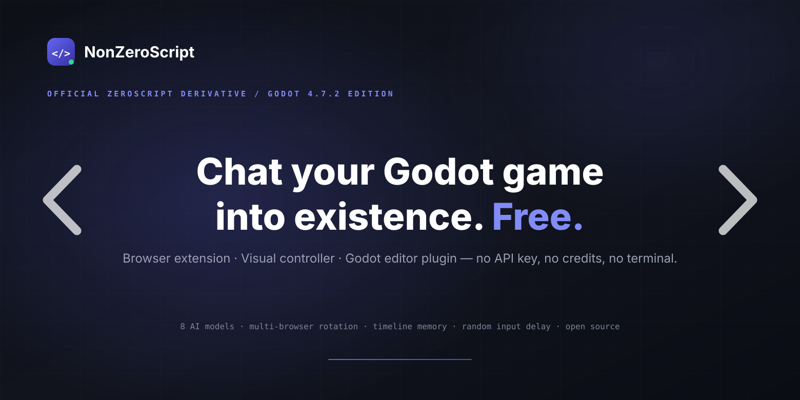

# NonZeroScript —— 免费的游戏编辑器 AI 智能体

-lightgrey)




**NonZeroScript** 是 **[ZeroScript](https://github.com/sebattfg/ZeroScript-Free) 的官方衍生版**，把原本面向 Roblox Studio 的 ZeroScript 重做成了**面向游戏编辑器**的版本。它让 ChatGPT、DeepSeek、Gemini、Kimi、GLM、Qwen、Meta AI、Arena 变成真正的编辑器智能体：读写 **GDScript 或 C#**、创建场景和节点、修改项目设置、运行游戏、读取报错——全部在普通的 AI 聊天页面里完成，**不需要 API Key，也不需要命令行**。

## 中文简介

- **它是什么：** 一个「浏览器插件 + 本地中转（带可视化操控台）+ 编辑器插件」的组合。你在 AI 聊天页点一下“启动”，之后在操控台里用中文写需求，AI 就会真的去改你的项目文件、场景和设置。
- **支持多个编辑器：** 浏览器插件和中转只认一套很小的编辑器无关协议，每个编辑器对应 `editor/` 下的一个插件文件夹。**现在已经内置 Godot 4.7.2（GDScript + C#）**；要支持 Unity、Unreal 或别的引擎，只需按 [`editor/PROTOCOL.md`](editor/PROTOCOL.md) 写一个适配器，不用改 agent。
- **不只是“三个浏览器”：** 打开多少个浏览器/标签页都行，每个会话都有“轮换”勾选；**勾一个就是单浏览器模式，勾两个以上才真正轮换**。
- **三档性能模式：** 极致性能（内存目标 **30 MB 以内**，实测 15–25 MB）、平均、最快速度，操控台里一键切换，立即生效。
- **平台：** 仅 Windows 10/11 与 macOS，**64 位和 32 位都支持，不提供 Linux 版本**。
- **免费开源：** GPL-3.0，无账号、无订阅、无 API Key，数据全部留在本机。

> **官方衍生版说明**：NonZeroScript 并不是第三方魔改，而是 ZeroScript 官方针对游戏编辑器（当前为 Godot 4.7.2）的衍生版本，与上游项目同步维护。本版本**不包含** Roblox Studio 集成、Roblox MCP 中转和 Roblox 专用说明；其余部分（浏览器插件的智能体循环、命令协议、永久免费承诺）都来自 ZeroScript，并继续使用 GPL-3.0 许可。

> 🌐 上游 ZeroScript：**[zerodev.tools/zeroscript](https://zerodev.tools/zeroscript)** · [github.com/sebattfg/ZeroScript-Free](https://github.com/sebattfg/ZeroScript-Free)

## 与 ZeroScript 的区别

| | ZeroScript（Roblox） | **NonZeroScript（Godot）** |
|---|---|---|
| 目标 | Roblox Studio（通过 MCP） | **任意游戏编辑器（通过插件）**，已内置 Godot 4.7.2 |
| 操控方式 | 聊天栏 + 命令行 Bridge | **可视化操控台 + 本地中转**，不用命令行 |
| 输入节奏 | 内部固定等待 | **每次模拟输入前，在最小/最大秒数之间随机等待** |
| 浏览器 | 单标签页 | **自己选择哪些浏览器参与**；两个以上自动轮换，共享时间线记忆 |
| 记忆 | Roblox 项目内记忆 | **按任务、按浏览器会话保存的时间线文件**，用于轮换时接续上下文 |
| AI 支持 | 8 家 | **8 家：ChatGPT、DeepSeek、Gemini、Kimi、GLM、Qwen、Meta AI、Arena**（ChatGPT 支持已更新） |

## 工作原理

```
 ┌─────────────────────────────┐        ┌──────────────────────────────┐
 │  浏览器（Chrome / Edge）      │        │  你的编辑器                    │
 │  ChatGPT · DeepSeek · Gemini │        │  editor/<适配器>/             │
 │  Kimi · GLM · Qwen · Meta    │        │  内置 Godot 4.7.2，           │
 │  Arena                       │        │  其他引擎可实现同一套协议      │
 │        ▲   浏览器插件         │        │        ▲   编辑器插件          │
 └────────┼─────────────────────┘        └────────┼─────────────────────┘
          │  本机 HTTP                            │  本机 HTTP 轮询
          ▼                                       ▼
 ┌──────────────────────────────────────────────────────────────────────┐
 │  controller/ —— 可视化操控台 + 本地中转 + 轮换 + 记忆                   │
 │  http://127.0.0.1:8790                                                 │
 └──────────────────────────────────────────────────────────────────────┘
```

1. **浏览器插件**运行在 AI 聊天页里：模拟输入任务 → 等待 AI 回答 → 解析出**一条**命令 → 上报给中转。
2. **中转（controller）**是一个很小的本地程序（只用 Python 标准库）：提供**可视化操控台**，决定下一回合交给哪个浏览器，把命令转发给 Godot，并写入时间线。
3. **编辑器插件**真正操作你的项目：文件、场景、节点、项目设置、试运行和日志。当前内置的是 Godot 4.7.2 适配器，协议对所有编辑器一致。

全程不经过任何云端服务；网络流量只发生在浏览器、中转和 Godot 之间的 `127.0.0.1`。

## 主要功能

- **用可视化操控台代替命令行。** 双击启动脚本后自动打开浏览器里的操控台：添加任务、查看会话、浏览时间线、调整延迟和轮换设置。
- **随机输入等待时间。** 可设置最小和最大秒数（例如 2–6 秒）。**每一次**模拟输入（启动提示、任务、命令结果）之前都会在该区间随机抽取一个时间等待，并在页面状态栏显示倒计时。
- **由你选择参与轮换的浏览器。** 打开任意数量的浏览器/标签页，分别在页面点“启动”，然后在操控台只勾选要参与的那几个：**勾 1 个 = 单浏览器模式，勾 2 个及以上 = 自动轮换**（round-robin），操控台会实时显示当前是哪种模式。新建任务时也可以指定只用某一家 AI。
- **三档性能模式。** **极致性能（内存目标 30 MB 以内）**、**平均**、**最快速度**。切换后日志条数、记忆条数、结果长度和轮询间隔会立即调整，不需要重启。
- **时间线记忆。** 每个浏览器里的 AI 记忆是独立的，轮换本会丢上下文。中转会把每次提示、回答、工具结果写入 `controller/data/memory/`，并在下一回合前给接手的浏览器附上一段**记忆摘要**。
- **真正可用的编辑器工具集。** Godot 适配器提供 29 个命令（GDScript 与 C#）：读写/搜索/编辑文件，查看和修改当前场景、增删节点、实例化场景、修改项目设置、运行/停止游戏、读取编辑器日志、保存截图给人类看。
- **ChatGPT 支持已更新**，同时支持 DeepSeek、Gemini、Kimi、GLM、Qwen、Meta AI、Arena。
- **完全免费开源**：GPL-3.0，无账号、无订阅、无 API Key。

## 下载与安装（共三部分）

> [`dist/`](dist) 里有四个独立的压缩包。前三个必须装，`prompts.zip` 是给 AI 的指令，供查看参考。
>
> | 压缩包 | 是什么 | 放哪里 |
> |---|---|---|
> | **`controller.zip`** | 可视化操控台 + 本地中转 | 放哪都行，双击启动脚本 |
> | **`extension.zip`** | Chrome / Edge 插件 | 加载已解压，文件夹保留 |
> | **`editor-godot-4.7.2.zip`** | Godot 4.7.2 插件 | 项目的 `addons/nonzeroscript` |
> | `prompts.zip` | 给 AI 的指令 | 只读参考 |
>
> 每个包里都有自己的 `INSTALL.txt`。解压后按下面三步装好即可。
>
> **平台说明：** 仅支持 **Windows 10/11** 和 **macOS**，**64 位与 32 位都可以**；**不提供 Linux 版本**，也没有 Linux 启动脚本或安装包。

### 1. 中转 + 可视化操控台

- 安装 **Python 3.9 或更新版本**（[python.org/downloads](https://www.python.org/downloads/)），不需要 `pip install`，只用标准库。
- 打开 `controller` 文件夹，双击：
  - **Windows 10/11（64 位 / 32 位）：** `start.bat`
  - **macOS（64 位 / 32 位）：** `start.command`（首次运行请右键 → 打开，或在“系统设置 → 隐私与安全性”里允许）
- 会打开一个控制台窗口，并自动在浏览器打开 **http://127.0.0.1:8790/**（可视化操控台）。

> 使用期间请保持这个窗口开启。关闭窗口就会停止中转。修改端口后需要重启。

### 2. 浏览器插件（Chrome / Edge 通用）

1. 打开 `chrome://extensions`（Chrome）或 `edge://extensions`（Edge）。
2. 开启右上角的 **开发者模式**。
3. 点击 **加载已解压的扩展程序**，选择 `extension` 文件夹。
4. 建议把 NonZeroScript 固定到工具栏。

解压后的 `extension` 文件夹就是插件本体，直接加载即可。

### 3. Godot 4.7.2 编辑器插件

1. 在发布压缩包（或仓库里的 `editor/godot-4.7.2`）中找到插件，把它复制到你的 Godot 项目，使路径变成：

   ```
   your_project/
     project.godot
     addons/
       nonzeroscript/
         plugin.cfg
         plugin.gd
         core/
         ui/
   ```

2. 在 Godot 中打开 **项目 → 项目设置 → 插件**，启用 **NonZeroScript**。
3. 右侧出现 **NonZeroScript** 面板；中转启动后应显示 `● 已连接`。
4. 确认面板里的中转地址是 `http://127.0.0.1:8790`。如果你改过端口，在这里同步修改并点“应用”。

编辑器插件从不监听外部连接，只会主动向本机中转发请求。

## Godot 新手教学（第一次完整流程）

1. **创建项目。** 打开 Godot 4.7.2，新建项目（例如 `MyFirstGame`）并打开。
2. **安装插件。** 按上面的第 3 步复制 `addons/nonzeroscript`，并在“项目设置 → 插件”里启用。
3. **启动中转。** 双击 `controller/start.bat`（Windows）或 `start.command`（macOS）。操控台自动打开。
4. **连接浏览器。** 加载插件后打开 **https://chat.deepseek.com**（推荐）或任意支持的 AI，**新建对话**，点击输入框上方的 **启动**。状态栏变绿并显示“已就绪 · 等待操控台派发任务”。
5. **在操控台添加任务。** 例如：

   > 给我的项目做一个主菜单：在 `res://scenes/main_menu.tscn` 新建场景，包含标题 Label、开始按钮和退出按钮；脚本放在 `res://scripts/main_menu.gd`，让按钮真正可用，并把项目主场景设置为这个菜单。

   点击 **加入队列**。中转会把第 1 回合派给浏览器。
6. **观察执行。** 页面状态栏先显示随机等待倒计时（`等待 4.2 秒后输入…`），随后 AI 思考，聊天里出现命令卡片，Godot 面板逐条记录命令；操控台的“实时日志”和“时间线记忆”同步显示。Godot 里的文件和场景会真实发生变化。
7. **继续迭代。** 任务完成后可以再添加一个：*“加一个设置面板，带音量滑块，用 ConfigFile 保存。”* AI 会保留上下文；也可以新开对话重新点启动。

### 好用的示例任务

- *“读取 `project.godot` 和场景树，然后添加一个 CharacterBody2D `Player`，WASD 移动，带摄像机；脚本保存到 `res://scripts/player.gd`。”*
- *“找出所有 GDScript 里的 `print(`，换成 `Logger.info()`，并添加 Logger 自动加载。”*
- *“这是 .NET 项目：新建 `res://scripts/Player.cs`，CharacterBody2D + WASD 移动，挂到 Player 节点后保存。”*
- *“做一个暂停菜单（CanvasLayer），包含继续 / 重开 / 退出，绑定到 `ui_cancel`。”*
- *“运行项目，然后读编辑器日志，修复前三个脚本错误。”*
- *“把窗口大小改成 1280×720，拉伸模式改为 `canvas_items`，修改默认清屏颜色。”*

### 小提示

- **小步快跑。** 一次做一个功能；AI 会先检查再修改，每条命令在操控台里都能看到。
- **保持操控台开启。** 它也是唯一能添加任务、查看哪个浏览器在工作的地方。
- **建议 2–6 秒延迟。** 太短虽然能用，但更像机器；类人的停顿更不容易触发 AI 站点的自动输入检测。
- **目前以文本工具为主。** 插件可以为你保存一张编辑器截图（`capture_editor_viewport`），但暂不会把截图发给 AI。

## 多浏览器轮换与记忆

可以混用浏览器、标签页和 AI，**参与哪些由你决定**：

1. Chrome 打开 DeepSeek，点 **启动**。
2. Edge 打开同一个 DeepSeek（或 ChatGPT、Gemini…），点 **启动**。
3. 操控台的“浏览器会话”里会出现两个会话。每个会话都有“轮换”勾选，卡片右上角还有 **全选轮换 / 全不选**。
4. 添加任务：**只勾 1 个**时任务全部在这一个会话上跑；**勾 2 个及以上**时自动轮流（第 1 回合第一个、第 2 回合下一个……）。会话区标题会显示 `轮换中 · N 个浏览器` 或 `单浏览器模式`。

数量不固定为 3：想开几个就开几个，取消勾选立刻生效，不需要关标签页。

由于每个标签页的聊天记忆独立，中转会在第 2 回合起附上记忆摘要：

```
MEMORY BRIEF (earlier turns of this task, newest last - possibly handled by another browser):
[TASK] 给我的项目做一个主菜单 ...
[10:31:02] Chrome · DeepSeek replied: 我先检查项目结构。
[10:31:05] tool get_editor_state -> OK: {"project_name": "MyFirstGame", ...}
Continue from the latest state. Do not repeat finished work.
```

记忆文件位于：

```
controller/data/memory/
  tasks/20261115-103000-a1b2c3d4.jsonl     # 一个任务 = 一条共享时间线
  sessions/Chrome-deepseek-9f3a2c11.jsonl   # 一个浏览器标签页 = 一条私有时间线
```

每一行都是一个带时间戳的事件。操控台里可以调整“记忆条数”，控制摘要长度。

不想让某个会话参与轮换：在操控台取消它的“轮换”勾选，或在页面点“停止”彻底脱离。

## 性能模式

操控台里有一个 **性能模式** 下拉框，切换后立即生效（不需要重启），所有数值都会写进 `controller/data/settings.json`，之后仍可单独微调。

| 模式 | 内存 / CPU / 磁盘 | 轮询间隔（浏览器 / 编辑器） | 日志条数 | 单条结果上限 | 适合场景 |
|---|---|---|---|---|---|
| **极致性能** | 最小；操控台底部显示真实内存，通常在 **15–25 MB** | 1.5 秒 / 1.0 秒 | 120 行 | 6 000 字符 | 笔记本、长时间无人值守、多个标签页 |
| **平均**（默认） | 中等 | 1.2 秒 / 0.4 秒 | 800 行 | 12 000 字符 | 日常使用 |
| **最快速度** | 最大 | 0.5 秒 / 0.25 秒 | 2 000 行 | 20 000 字符 | 单项目、追求响应速度 |

- 模式还决定记忆摘要条数、内存里保留多少个已完成任务、以及操控台重绘频率。
- **记忆保留天数**：启动时和保存设置时清理 `controller/data/memory/` 里过期的旧时间线；填 `0` 表示永久保留。
- 编辑器插件也会收到中转下发的轮询间隔（`settings.poll_ms`），所以极致性能模式会同时降低 Godot 插件的轮询频率。
- 操控台底部显示的是**真实**常驻内存（`/api/status → perf.rss_mb`），不是估算值。

## 输入节奏设置

操控台 → **输入节奏**（这些数值由性能模式设置，之后可以单独微调）：

- **最小秒数 / 最大秒数** —— 随机等待区间。每次模拟输入都会重新抽取，并在页面显示倒计时。
- **最大回合** —— 单个任务的回合上限。
- **记忆条数** —— 轮换时附带的最近时间线事件数。
- **多浏览器轮换** —— 是否轮流派发（至少勾选两个会话才有意义）。
- **追加给 AI 的自定义指令** —— 追加在系统提示末尾（代码风格、命名规范、引擎版本注意事项等）。

## 支持的 AI

| AI | 地址 | 说明 |
|---|---|---|
| **DeepSeek** | chat.deepseek.com | 推荐，速度快、工具调用稳定 |
| **ChatGPT** | chatgpt.com | 已适配新版输入框；图片输入默认关闭（免费额度限制） |
| **Google Gemini** | gemini.google.com | 长会话偶尔不再使用工具，可新开会话 |
| **Kimi** | kimi.ai | 有时会使用自己的原生工具而不用命令 |
| **GLM** | chat.z.ai | 建议 GLM-5.2；高峰期 z.ai 可能繁忙 |
| **Qwen** | chat.qwen.ai | 建议选择支持工具调用的模型 |
| **Meta AI** | meta.ai | 页面支持图片，但 NonZeroScript 只发文本命令 |
| **Arena** | arena.ai | 模式必须保持 **Direct**；Battle / Side-by-side / Agent 会被阻止 |

八家共用同一套命令协议，可以自由轮换。操控台新建任务时也可以指定只用某一家。

## 页面状态栏说明

| 圆点 | 含义 |
|-----|------|
| 绿色 | 已连接中转、会话已启动、可以接任务 |
| 黄色 | 已连接但尚未启动——点 **启动** |
| 红色 | 中转离线或启动失败（看提示） |
| 闪烁 | 正在随机等待、输入或等待 AI |

## AI 可以使用的命令

| 分组 | 命令行 |
|---|---|
| 读取 | `list_tools`、`get_editor_state`、`list_files`、`read_file`、`search_in_files`、`get_scene_tree`、`get_node_info`、`get_project_settings`、`get_editor_log`、`capture_editor_viewport` |
| 文件 | `write_file`、`write_files`、`edit_file`、`create_dir`、`delete_path`、`rename_path`、`scan_filesystem` |
| 场景 | `add_node`、`attach_script`、`remove_node`、`set_node_property`、`select_nodes`、`instantiate_scene`、`open_scene`、`create_scene`、`save_scene` |
| 项目 / 运行 | `set_project_setting`、`run_project`、`stop_project` |

脚本使用显式代码块，不必塞进 JSON 转义。**GDScript** 用 `###GDSCRIPT###`，**C#** 用 `###CSHARP###`，语言由文件扩展名决定：

````
{"command": "write_file", "params": {"path": "res://scripts/player.gd"}}
###GDSCRIPT###
extends CharacterBody2D

@export var speed: float = 300.0

func _physics_process(_delta: float) -> void:
	var dir := Input.get_vector("ui_left", "ui_right", "ui_up", "ui_down")
	velocity = dir * speed
	move_and_slide()
###END_GDSCRIPT###
````

````
{"command": "write_file", "params": {"path": "res://scripts/Player.cs"}}
###CSHARP###
using Godot;

public partial class Player : CharacterBody2D
{
    [Export] public float Speed { get; set; } = 300.0f;

    public override void _PhysicsProcess(double delta)
    {
        var dir = Input.GetVector("ui_left", "ui_right", "ui_up", "ui_down");
        Velocity = dir * Speed;
        MoveAndSlide();
    }
}
###END_CSHARP###
````

### GDScript 与 C#

两种语言都是一等公民，插件不会把一种改写成另一种。

| 项目 | GDScript | C# |
|---|---|---|
| 脚本文件 | `.gd` | `.cs` |
| 代码块 | `###GDSCRIPT### … ###END_GDSCRIPT###` | `###CSHARP### … ###END_CSHARP###` |
| Godot 版本 | 任意 4.7.2 | 必须 **.NET 版** 4.7.2 |
| 类名 | 自动 | 必须与文件名一致（`Player.cs` → `class Player`） |
| 挂脚本 | `attach_script`、`add_node.script_path` | 同样的命令 |

- `get_editor_state` 会返回 `csharp`（当前编辑器能否编译 C#）、`dotnet`（项目里是否有 `.sln`/`.csproj`）和 `language`。AI 会先读这些信息再决定用哪种语言，不会往纯 GDScript 项目里塞 `.cs`。
- 标准（非 .NET）版 Godot 里仍然可以写 `.cs` 文件，但结果会带 `warning`，`attach_script` 会直接拒绝并给出明确原因，而不是静默失败。
- C# 由 Godot 自己编译，插件不会调用 `dotnet`。运行时如果缺少脚本，请在 MSBuild 面板点 **Build**；`run_project` 的返回里也会提示。
- C# 项目需要 .NET SDK，这是 Godot 自身的要求，与 NonZeroScript 无关。

插件会拒绝 `res://`/`user://` 之外的路径，保护 `.git`、`.godot`、插件本身和 `project.godot`；删除文件夹必须显式 `recursive=true`。也可以在 Godot 面板里直接关闭“允许 AI 写入”。

## 其他编辑器

操控台和浏览器插件并不认识 Godot，它们只认 [`editor/PROTOCOL.md`](editor/PROTOCOL.md) 里的那一套协议；每个编辑器就是一个文件夹（`editor/<引擎名>/`）、一个插件、一套相同的命令。**目前提供的是 Godot 4.7.2**，它同时是参考实现：29 个命令、GDScript + C#、可撤销的场景编辑、路径保护、写入开关。Unity、Unreal 等引擎按同一套协议接入，浏览器插件和操控台不用改。

## 环境要求

- **Godot 4.7.2**（插件按 4.7.2 编写；相邻 4.x 版本或许可用，但未测试）
- C# 项目另需 **Godot 4.7.2 的 .NET 版**和 .NET SDK；纯 GDScript 项目不需要
- **Chrome 或 Edge**（Chromium 111+，Edge 使用同一个插件包）
- **Python 3.9+**（中转，仅标准库）；32 位系统请安装 32 位 Python
- **Windows 10/11**（64 位 / 32 位）或 **macOS**（64 位 / 32 位）
- **不支持 Linux**，也没有 Linux 安装包或启动脚本

## 常见问题

**操控台显示“Godot 未连接”。**
在 Godot 里打开项目并启用插件（项目设置 → 插件），确认面板地址与中转一致，然后点“重新连接”。

**页面显示“中转未运行”。**
先启动控制器；如果端口不同，在插件弹窗和 Godot 面板里改成同一个地址。

**8790 端口被占用。**
关闭另一个控制器，或换一个端口启动，并把同样的地址填进浏览器插件弹窗和 Godot 面板。

**AI 只回文字，不出命令。**
在聊天里提醒它“只发一条 NonZeroScript JSON 命令”，或新开会话。Arena 必须用 Direct 模式；Kimi、Gemini 偶尔会用自己的工具，DeepSeek 最稳定。

**AI 网站改版后页面状态栏不见了。**
AI 站点偶尔会改界面，插件会跟着更新；在更新之前，换一家 AI（DeepSeek、ChatGPT）可以继续用，操控台不受影响。

**任务自己结束了。**
协议是“每条回复最多一条命令”；没有命令的回复代表“任务完成或需要你决策”。操控台会显示最后的回复，继续添加任务即可。

**怎么清空记忆？**
停止控制器后删除 `controller/data/memory/`。所有设置和记忆都是本地文件，不会上传。

## 致谢与许可

NonZeroScript 以 GPL-3.0 开源，是 **ZeroScript 官方 Godot 衍生版**；面向 Roblox Studio 的上游项目仍是 ZeroScript。原始构想、智能体循环和各家 AI 适配来自 ZeroScript 作者；Godot 插件、可视化操控台、轮换和时间线记忆是本版本新增。

- 上游 ZeroScript：[github.com/sebattfg/ZeroScript-Free](https://github.com/sebattfg/ZeroScript-Free)
- 本仓库：[github.com/Moonano-MG/NonZeroScript](https://github.com/Moonano-MG/NonZeroScript)

遇到问题请附上操控台的“实时日志”和页面状态栏当时显示的内容，这样最容易定位。

## License

GPL-3.0-or-later，详见 [LICENSE](LICENSE)。
